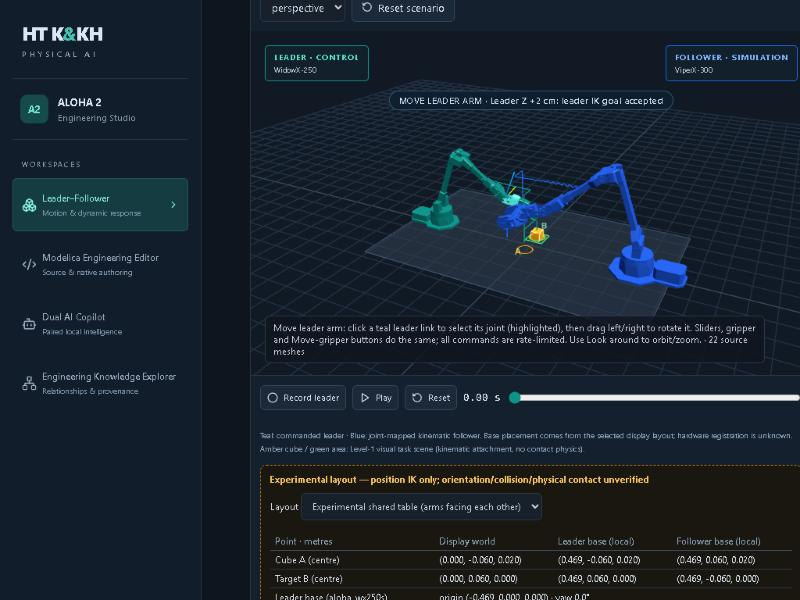

# Step 4C — Shared workspace frames and experimental shared-table layout

Status (17 Oct 2026): implemented and verified in the running studio. **Experimental display layout only: position
IK checked offline; grasp orientation, collision, physical contact and hardware registration are unverified, and the
related automation stays disabled.**



## What was wrong (diagnosis from the actual code)

| Finding | Where | Effect |
|---|---|---|
| Base placement was X offsets hard-coded in five places (`FOLLOWER_OFFSET`, `LEADER_OFFSET`, literals `-0.5`, `+0.5`, `0.45`/`-0.5` in trails) | `web/src/RobotStage.tsx` | Display, EE sphere, drag target and trails could drift apart; no rotation possible. |
| Task scene drawn as follower-local + 0.45 | `RobotStage.tsx` | Cube/target were not world objects; the leader could not reach them (Step 4 audit). |
| Step 4B "best candidate" assumes both bases face +X | `reports/workspace_candidate.json` | Cube A at follower-local x = −0.53 m: the follower reaches **behind its own base** (waist −2.98 rad). Position IK is feasible, the layout is not coherent. |
| Checklist "near cube" compared the leader-local EE with the follower-frame cube | `LeaderFollower.tsx` | Frame mix-up after the leader-IK fix of Step 2. |
| Two status chips at the same screen position | `RobotStage.tsx` | Overlapping text. |

## What was implemented

* **Single source of truth** `config/workspace/aloha2_display_layouts.json`: named layouts with leader/follower base
  pose (xyz + yaw) and table, read by both Python and the web UI.
  * `legacy_side_by_side` — the historic X offsets (−0.5 / +0.45), task scene in the follower frame.
  * `experimental_shared_table` (default) — the ALOHA reference mounting convention (MuJoCo Menagerie
    `aloha/aloha.xml`, BSD-3-Clause; values only, no assets): bases at x = ∓0.469 m, follower yawed π (facing the
    leader); table 1.22 × 0.74 m from the Menagerie scene, top at z = 0. Deviations are documented in the file.
* **Typed frame abstraction**
  * `web/src/workspaceFrames.ts`: `world()`, `local(role, …)`, `toWorld`, `toLocal`, `poseToWorld` (position +
    quaternion), `restingZ`, `GATES`. Points are branded with their frame; `workspaceFrames.typecheck.ts` makes the
    build fail if a follower-local point can be converted as leader-local or a raw array used as a world point.
  * `kkh/engineering/workspace_frames.py`: the same transforms with `LocalPoint(role, xyz)`, `convert`, URDF IK
    checks (position only and gripper-pointing-down), `search_task_points`, `audit_layout` →
    `reports/workspace_layout.json`.
* **Task points from evidence, not chosen by hand**: `search_task_points` evaluated 20 shared tabletop pairs (B = A +
  12 cm in Y); 12 are reachable by both arms with position error < 5 mm and gripper pointing down within 5°. The most
  central pair is used: **A = (0, −0.06, 0.02) m, B = (0, +0.06, 0) m** (cube centre = table top + half cube height).
  In base frames: leader (0.469, ∓0.06, …), follower (0.469, ±0.06, …); waist ≈ ±0.13 rad for both arms.
* **Scenario** `config/scenarios/aloha2_cube_transfer_shared.json` (`aloha2-cube-transfer-shared` 0.1.0-experimental),
  expressed in the display world of the shared layout. The leader demonstrates (the cube rule follows the leader
  gripper); the **follower attempt** is the joint-mapped replay of the same recording, evaluated separately with
  `GET /api/workbench/trajectory/{id}/task?manipulator=follower`. The legacy scenario `aloha2-cube-transfer` 1.0.0 is
  unchanged, so earlier recordings keep their evaluation.
* **Renderer**: robots, EE sphere, drag target, trails, table, cube, target and A/B labels all go through
  `workspaceFrames`; the camera centres between the bases; one status chip.
* **Indicator panel** under the stage: the notice *"Experimental layout — position IK only; orientation/collision/
  physical contact unverified"*, layout selector (legacy / experimental), cube A and target B in display world,
  leader-local and follower-local coordinates, base poses, evidence text and the gate list.
* **Gates stay closed**: `enable_ab_shortcuts`, `grasp_automation`, `hardware_motion`, `hardware_registration`,
  `robot_table_collision`, `leader_follower_collision`, `physical_contact_3d`, `grasp_orientation_about_vertical`
  are false in Python, TypeScript and the API; Above A/B still only explain why they are disabled.
* **Traceability**: recordings store the layout name, status and base poses (`traceability.layout`).
* Step 4/4B audits no longer regex-parse `RobotStage.tsx`; they read the legacy layout (`legacy_offsets()`), and their
  results are unchanged.

## Verified (17 Oct 2026, this machine)

* `npm run build` passes (includes the frame-misuse type checks); `node --test web/src/workspaceFrames.test.ts`:
  6 passed.
* `pytest tests/test_workspace_frames.py tests/test_workspace_registration.py tests/test_workspace_candidate.py`:
  all pass; full suite **100 passed**.
* Browser: one table, two robots, one cube, one target, A/B labels. With the leader buttons only (Open → X+ ×12 →
  Y− ×3 → Down ×11 → Close → Up ×3 → Y+ ×6 → Down ×3 → Open), the leader picked the cube at A and released it on B.
  Switching to the legacy layout shows the Step 4 numbers (A world 0.75, leader-local 1.25, follower-local 0.30).
* Backend test: a scripted leader demonstration completes the task; the joint-mapped follower attempt of the same
  recording does **not** (it is mirrored to the other side of the table). That is the expected, honest result until
  retargeting exists.

## Remaining gates (not done)

1. Collision checking (robot/table, leader/follower). In the browser, the joint-mirrored follower swings into the
   middle of the table while the leader works there.
2. Grasp orientation about the vertical axis and finger geometry; 3D contact (Modelica contact experiments remain
   reduced-order surrogates).
3. Retargeting of the leader demonstration to a follower attempt (Cartesian/world-frame), then evaluation of the
   follower attempt in OpenModelica on the shared table.
4. Hardware registration of the bases (none exists; every transform is a display convention).
5. Only after 1–4: Above A/B, grasp automation, training success or hardware motion.

## How to check yourself

```powershell
cd E:\users\opt2.ai\NOVA\ai-kkh-physicalai
.\.venv\Scripts\python.exe -m pytest tests/test_workspace_frames.py tests/test_workspace_registration.py tests/test_workspace_candidate.py -q
node --test web/src/workspaceFrames.test.ts
.\.venv\Scripts\python.exe -m kkh.engineering.workspace_frames            # -> reports/workspace_layout.json
.\.venv\Scripts\python.exe -m kkh.engineering.workspace_frames --search --output runs/workspace_search.json
```
Then open the studio → Leader–Follower: the amber notice and coordinates sit below the 3D stage; the layout selector
switches between legacy and experimental.
