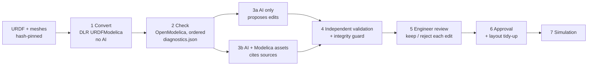

# From robot file to approved physics model

### The HT GEN7 PhysAI Studio engineering pipeline

Engineering-Grounded Physical AI

<div class="abs-br m-6 text-sm opacity-60">Branch feat/urdf-repair-pipeline · measurements of 21–23 Oct 2026</div>

---

# The question

A robot comes with a **description file (URDF)**: parts, joints, masses, inertias. To test it before it moves, we need an
**executable physics model** (Modelica) that OpenModelica can simulate.

<v-clicks>

- Writing that model by hand is slow and error-prone.
- Can **AI** help, and how do we **know** its result is right?
- Everything runs **locally**: local AI models (Ollama), OpenModelica, MuJoCo. No cloud, no invented numbers.

</v-clicks>

<div class="mt-8 p-3 rounded bg-blue-500/10 text-sm">
<b>In plain words:</b> we turn a robot's "parts list" into a simulation, and we measure whether the simulation is
faithful, instead of trusting whoever produced it.
</div>

---

# What we measured first: AI as the author

Three ways to convert the same robot file, scored by 8 measured checks (readable, complete, runs, every part present,
geometry, axes and masses, torques vs MuJoCo).

| Method | ALOHA leader arm (21 Oct) | SO-101 arm (22 Oct) |
|---|---|---|
| **DLR URDFModelica** (rule-based, no AI) | runs; only defect: finger mimic | **8/8 in 23 s**, torques within 0.01 % |
| AI only (local models: 3 on ALOHA, 2 on SO-101) | no file passes "complete" | best 2/8 |
| AI + library search | no file passes "complete" | best **6/8** (qwen3-coder 30B): masses right, joint positions missing |

<v-click>

**Lesson:** today's local AI does not write a trustworthy model. A proven converter does most of the work, but it is
not perfect either.

</v-click>

---
layout: two-cols
---

# Why a pipeline

**What the measurements told us**

- The converter is **reproducible** and copies every URDF value.
- It still leaves **real defects** (dropped mimic joint, start pose outside limits, unresolvable mesh paths).
- AI can **locate** some errors, but its fixes can also **break** a model.
- An AI that sounds sure is not evidence.

::right::

# &nbsp;

**So we reversed the roles**

1. A **deterministic converter** writes the model.
2. **OpenModelica checks** it in a fixed order.
3. **AI only proposes** repairs, on a copy.
4. Every proposal is **re-validated independently**.
5. An **engineer decides**. Nothing reaches the approved model without a human.

<div class="mt-6 p-3 rounded bg-blue-500/10 text-sm">
<b>In plain words:</b> the AI becomes an assistant with a checker looking over its shoulder, not the author.
</div>

---

# Who is DLR?

**Deutsches Zentrum für Luft- und Raumfahrt**: the **German Aerospace Center**, Germany's national research centre for
aeronautics and space.

<div class="grid grid-cols-3 gap-4 mt-6">
<div class="p-4 rounded bg-gray-500/10"><div class="text-3xl font-bold">≈ 11 800</div>staff (2024)</div>
<div class="p-4 rounded bg-gray-500/10"><div class="text-3xl font-bold">51</div>institutes and facilities</div>
<div class="p-4 rounded bg-gray-500/10"><div class="text-3xl font-bold">1.7 bn €</div>research and operations budget (2024)</div>
</div>

- Headquarters in Cologne; about 30 sites in Germany.
- Hosts the **German Space Agency**, which runs the national space programme.
- A **Helmholtz** research centre: public, peer-reviewed research.

<div class="abs-bl m-6 text-xs opacity-60">Sources: DLR "About us" and careers brochure; Helmholtz Association (see last slide)</div>

---

# Why DLR is credible for this job

<div class="grid grid-cols-2 gap-6">
<div>

### In Modelica (the language we simulate in)

- The **MultiBody library** of the Modelica Standard Library, which **every model in our studio uses**, lists its
  library officers at **DLR's Institute of System Dynamics and Control**.
- **Martin Otter** (DLR) chaired the **Modelica Association from its foundation in 2000 until 2024**, and is credited
  as one of the main designers of the Modelica language and Standard Library. The current chair, Dirk Zimmer, is also
  from DLR.

</div>
<div>

### In robotics

- DLR's **Institute of Robotics and Mechatronics** built the lightweight robot arm LWR III (2003), **licensed to KUKA in
  2004**; it became the KUKA **LBR iiwa** (2013).
- The KUKA-DLR arm won the **euRobotics Technology Transfer Award 2011**.

### The converter itself

- **URDFModelica** (DLR-RM), open source, **BSD-3-Clause**, v0.3.3 (2025), authors with ORCID ids.
- **2nd prize, Library Award**, 16th International Modelica & FMI Conference (2025).

</div>
</div>

---

# Credible, and still checked

What the pipeline measured on the DLR output (ALOHA 2 follower arm, Stage 1 and Stage 2, 23 Oct):

| Strength | Measured |
|---|---|
| Reproducible | second conversion: **63 files byte-identical** |
| Faithful copy | **255 URDF values** compared, **0 differ** |
| Sound structure | balanced (7 217 equations = 7 217 unknowns), simulates |
| Physics | torques within 5 % of MuJoCo on 8/8 joints |

| Limit found | Consequence |
|---|---|
| URDF **mimic** recorded but not used | right finger up to **52.9 mm** off |
| Test model starts fingers **outside their limits** | 2 runtime warnings |
| Mesh paths rewritten to `package:_/…` | no tool finds the shapes |
| 18 of 49 connections without a drawn line | diagram incomplete (graphics only) |

<div class="text-sm opacity-80">Credibility is why we use it as the author; measurement is why we still check it.</div>

---

# The pipeline



- Every artefact records the **hash of its inputs**: a run can be traced from robot file to approved model.
- The AI never writes to the approved model; it edits **isolated copies** only.

---

# Stages 1 and 2: convert, then check in order

<div class="grid grid-cols-2 gap-6">
<div>

### 1 · Convert (no AI)

- Pinned converter version, recorded arguments and pre-processing.
- **Manifest**: URDF and mesh hashes, Python and OpenModelica versions.
- Mapping table: every URDF link and joint → Modelica class and parameters.
- List of what the converter **ignores** (e.g. `ros2_control`, mimic).

</div>
<div>

### 2 · Check (OpenModelica)

1. Load and parse
2. Structure (`checkModel`)
3. Balance and translation
4. Baseline simulation
5. **URDF consistency**: geometry, axes, masses, inertia, torques vs MuJoCo
6. Graphics (separate, never decides the verdict)

Every finding is machine-readable: id, step, category, severity, location, evidence.

</div>
</div>

---

# Stage 3: AI repair, a fair two-arm experiment

| | AI only | AI + Modelica assets |
|---|---|---|
| Local model, seed 42, temperature 0, 3 attempts | ✓ | ✓ |
| Same findings, same budget, same file-selection rule | ✓ | ✓ |
| Governed knowledge: **1 730 chunks** of the Modelica Standard Library 4.1.0, ModelicaReference, 5 validated project patterns, each with version and licence | — | ✓ |
| Must **cite** the chunks it used (invented ids are flagged) | — | ✓ |

**Frozen fault set v1**: 10 deliberate defects injected into the converted arm, frozen **before** any repair was run;
3 are **held out** (F08–F10), so no pattern names them directly.

F01 missing semicolon · F02 MSL 3 class name · F03 misspelled class · F04 limit in degrees · F05 axis sign flipped ·
F06 frame rotated 90° · F07 connection deleted · F08 wrong array index · F09 rounded mass · F10 conflicting initial equation

---

# Stage 4: independent validation and integrity guard

- The full Stage 2 is run **again** on every candidate, independently of who produced it.
- Findings are matched before/after: **resolved**, **remaining**, **new**.
- A candidate that fails at an earlier gate than before is **regressed**.

**Integrity guard**: a "fix" is **rejected** even if it compiles when it

- deletes files, components, connections or assertions,
- changes a value that comes from the URDF,
- or only edits annotations (cosmetic changes hiding a problem).

<div class="mt-6 p-3 rounded bg-blue-500/10 text-sm">
<b>In plain words:</b> deleting the broken part makes the error disappear, but it is not a repair. The guard catches it.
</div>

---

# Stages 5–7: the engineer decides

- **Review**: keep or reject each proposed edit (re-applied to a fresh copy), amend by hand as a new version, re-check,
  open in OMEdit.
- **Approval** requires a validated candidate, **or** a written justification with the open findings recorded.
- **Layout pass** after approval: deterministic, diagram annotations only (ALOHA follower: **18 → 0** unrouted
  connections).
- **Simulation** of the approved model.

Verified end to end on a dry run: candidate → validation → **unjustified approval refused** → justified approval →
layout → simulation.

---

# Results of the repair campaign (23 Oct, ALOHA 2 follower)

**qwen3-coder 30B**, 4 cases (the natural defect + 3 faults)

| Arm | Validated | Improved | Rejected by integrity guard | Findings resolved / new |
|---|---|---|---|---|
| AI only | 0 | 1 | **2** | 12 / 2 |
| AI + Modelica assets | 0 | **2** | 0 | 10 / 1 |

**nemotron-3-nano 4B**, 11 cases (natural + F01–F10)

| Arm | Validated | Improved | Regressed | Findings resolved / new |
|---|---|---|---|---|
| AI only | 0 | 0 | 1 | 6 / 3 |
| AI + Modelica assets | 0 | 0 | 2 | 16 / 7 |

<v-click>

**Reading:** no AI repair was fully validated. With the 30B model, governed knowledge helped (more improvements, no
rejected "fixes"); the small model did not repair anything. One model, these cases, these settings: not a general ranking.

</v-click>

---

# Architecture of the code

```text
kkh/workflow   the engineering pipeline (new)
  stage1_convert → stage2_check → stage3_repair (AI only | AI + assets) → stage4_validate → review / approve
  + faults (frozen fault set) · assets (Modelica knowledge with provenance) · layout (diagram tidy-up)
  + campaign (measured reports)

kkh/convert    reused building blocks
  urdfmodelica (DLR converter) · score (8 measured checks) · excite · dynamics (MuJoCo)
  llm (AI writer, loop guard, token budget) · library_index (BM25) · review / review_score
  robot3d · replay · export

kkh/engineering  URDF parser + kinematics, OpenModelica service, result reader
kkh/llm          Ollama client (local models only)
kkh/semantic + kkh/rag   GraphDB knowledge graph, GraphRAG
kkh/domain/aloha · kkh/studio
```

Web front end: React + TypeScript + three.js. Back end: FastAPI. Engines: OpenModelica 1.27.1 + MSL 4.1.0, MuJoCo 3.16,
Ollama, GraphDB.

---

# What this shows, and what it does not

<div class="grid grid-cols-2 gap-6">
<div class="p-4 rounded bg-green-500/10">

### Shows

- A traceable path from robot file to approved model.
- Where the trusted converter is right, and exactly where it is not.
- Whether an AI repair helps, measured on frozen faults, with damaging "fixes" caught.
- That a human approval is enforced, not optional.

</div>
<div class="p-4 rounded bg-orange-500/10">

### Does not show

- That the model matches the **real robot**: no motors, friction or controllers in the URDF, no hardware data.
- A general ranking of AI methods: one robot, one fault set, two local models.
- Contact, grasping or balance.

</div>
</div>

---

# Next steps

1. **Simulate** step with levels: drop under gravity → hold a pose (is the motor strong enough?) → reach and place →
   humanoid scenarios with a fixed base.
2. More robots through the pipeline (SO-101, humanoids) and a second frozen fault set.
3. Close the knowledge gap on diagram annotations (Modelica Language Specification, CC BY-SA 4.0, pending approval).
4. A human review baseline for the comparison.

<div class="mt-10 text-xl">AI can assist robot-model engineering, <b>if every proposal is measured and a human decides.</b></div>

---

# Sources

**DLR**
- [DLR: About us](https://www.dlr.de/en/dlr/about-us) · [DLR at a glance](https://www.dlr.de/en/dlr/dlr-at-a-glance) · [Helmholtz: German Aerospace Center](https://www.helmholtz.de/en/about-us/helmholtz-centers/centers-a-z/german-aerospace-center-dlr/)
- [History of the DLR LWR](https://www.dlr.de/en/rm/research/robotic-systems/arms/lwr-iii/history-of-the-dlr-lwr) · [The KUKA-DLR Lightweight Robot arm (IEEE)](https://ieeexplore.ieee.org/document/5756872)
- [Modelica Association: new chair press release (2024)](https://modelica.org/news/2024-05-29-newchairpr/) · [Modelica Association](https://modelica.org/association) · [DLR-SR: about us](https://www.dlr.de/en/sr/about-us)
- Modelica Standard Library 4.1.0, `Modelica.Mechanics.MultiBody.UsersGuide.Contact` (library officers, DLR-SR)
- [URDFModelica (DLR-RM) on GitHub](https://github.com/DLR-RM/urdfmodelica): README, `CITATION.cff` (v0.3.3, 2025-09-02)

**Our measurements** (this repository)
- `reports/CONVERT_REVIEW_CAMPAIGN_2026-10-21.md` (conversion and review campaign, SO-101 addendum)
- `reports/workflow/STAGE1_ALOHA_VX300S.md`, `STAGE2_ALOHA_VX300S.md`, `ASSETS_V1.md`
- `reports/workflow/REPAIR_CAMPAIGN_qwen3_coder_30b.md`, `REPAIR_CAMPAIGN_nemotron_3_nano_4b.md`
- `docs/REPAIR_PIPELINE_PROPOSAL.md`
