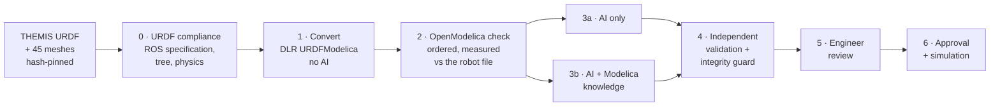

HT GEN7 PhysAI Studio · Engineering-Grounded Physical AI

# THEMIS, from robot file to trustworthy physics model

How we turn a humanoid's description file into a simulation an engineer can trust: a proven converter, measured checks, AI that only proposes, and a person who decides.

  
<b>44</b>joints

  
<b>45</b>parts

  
<b>37.9 kg</b>total mass in the file

  
<b>100 %</b>local: no cloud, no invented numbers

Westwood Robotics THEMIS TH02-A7 · official URDF, Apache-2.0

---

# The problem

A robot ships with a **description file (URDF)**: its parts, joints, masses and inertias. Before the robot moves, engineers want a **physics model** (Modelica) to simulate it.

<v-clicks>

- Writing that model by hand takes weeks and invites mistakes.
- Converters exist, but they **silently drop or rewrite** things.
- AI can write code fast, but a model that **runs** can still describe **another robot**.
- So the real question is not "can AI do it?", but **"how do we know the result is right?"**

</v-clicks>

<b>In plain words:</b> we turn a robot's parts list into a simulation, and we <b>measure</b> whether it is faithful instead of trusting whoever produced it.

---

# Why THEMIS

<b>In production.</b> TH02-A7 is the THEMIS model Westwood builds today: 7-DoF arms, three-finger EN02 hands.

<b>Official file.</b> Published by Westwood Robotics, Apache-2.0, exported from SolidWorks.

<b>Real and current.</b> Exactly the kind of robot file our customers bring.

The studio's start screen: THEMIS as the main target, rendered from its own URDF and meshes.

---

# The concept: one pipeline, every step measured

<b>Converter writes.</b> DLR URDFModelica: reproducible, every value traceable to the file.

<b>Measurement decides.</b> OpenModelica, URDF kinematics and MuJoCo torques: no opinion, only numbers.

<b>AI proposes, people decide.</b> AI edits copies only; nothing is accepted without an engineer.

---

# Step 0 · Is the file valid?

<b class="text-red-600">2</b>errors

<b class="text-orange-600">133</b>warnings

<b>All 44 joints:</b> limits, effort and velocity left at 0 by the exporter. <b>Two thumbs:</b> inertia rounded to 0, impossible for a real body. Found in under a second, with the line and the rule.

URDF compliance on THEMIS: verdict, plain-language note, counts per layer.

---

# The engineer stays in charge

A refused file can still be converted: <b>"Convert anyway (engineer override, recorded)"</b>, exactly as published, nothing corrected or invented.

The refusal stays in the run. Live progress shows each real step: compliance (overridden), conversion in 3 s, OpenModelica check in about 3 min.

Launching THEMIS: live progress, with the override and its explanation.

---

# Step 1 · Convert, without AI

<b>845/845</b>URDF values copied unchanged

<b>45/44</b>parts / joints mapped

<b>yes</b>reproducible

<b>DLR URDFModelica</b> (German Aerospace Center, Modelica Library Award 2025). Everything it drops or rewrites is listed.

The eight-step rail (red = a step that did not pass) and the conversion record.

---

# Step 2 · OpenModelica check

<b>Sound structure:</b> 25 600 equations = 25 600 unknowns; it simulates.

<b>Not the robot yet:</b> motion and torques do not match the file; torque-limit warnings because every effort limit is 0.

Every failure: <b>"What went wrong, in simple terms"</b>: what, why it matters, what fixes it.

THEMIS's verdict with its plain-language explanation.

---

# Step 3 · AI Repair Comparison

<b>Identical conditions:</b> same local model, seed, rules, findings and attempts. <b>AI only</b> against <b>AI + Modelica knowledge</b>.

<b>Knowledge v2, 3 036 passages, all licensed:</b> Modelica Language Specification 3.7, OpenModelica error messages, MSL 4.1.0 and its 3→4 rules, OpenModelica guide, project patterns. Must be cited.

THEMIS's AI Repair Comparison running with qwen3-coder 30B, entirely on this laptop.

---

# Step 4 · Checked, never trusted

<!-- REPAIR_RESULTS -->

<b>Independent validation:</b> the full OpenModelica check runs again on every candidate; findings are matched as resolved, remaining or new.

<b>Integrity guard:</b> a "fix" that deletes a part, a connection or a check, or changes a value from the robot file, is rejected even if it compiles.

---

# Steps 5–6 · The engineer decides

<b>Review</b> Keep or reject each proposed edit, amend by hand, re-check, open in OMEdit.

<b>Approve</b> Only a validated model, or one with a written justification and its open findings recorded.

<b>Before &amp; after</b> Download any version for OMEdit, or every version side by side with its changes (diff).

Nothing reaches the approved model without a person. Every decision is recorded with its author and reason.

---

# Explore THEMIS in 3D

Drawn from the <b>same file</b> that is converted.

Every joint moves through the <b>test motion</b>, slow or real speed.

Parts passing through each other turn <b>red</b>.

Centre of mass; point at a part for its name, mass and joint.

THEMIS in the interactive 3D view.

---

# Same pipeline, other robots

| Robot | Stage 0 | Converter → check | What the pipeline found |
|---|---|---|---|
| **THEMIS TH02-A7** | implausible | simulates, checks fail | zero joint limits and efforts, two impossible thumb inertias |
| Unitree G1 + Dex3-1 | compliant | simulates, checks fail | 43 joints, end to end in about 3 min |
| Berkeley Humanoid Lite | compliant | **fails at structure** | a **converter bug**: the `imu` sensor link written twice |
| ALOHA 2 follower arm | compliant | simulates, checks fail | finger "mimic" dropped by the converter: 52.9 mm off |

The pipeline catches problems in the <b>vendor file</b> (THEMIS), in the <b>converter</b> (Berkeley, ALOHA) and in the <b>AI's repairs</b>: three different sources of error, one method.

---

# Built for non-experts too

- A **Guide**: what you do, what happens, what you get, and why, for every step.
- **"What the AI receives"**: the exact request, its sources, and how the knowledge is used.
- Two levels of detail: **Overview** and **Engineering**.
- A **Physical AI Atlas** of the underlying ideas.

The Guide.

---

# What THEMIS teaches us

### For Westwood's file

- Enter real **joint limits, efforts and velocities** in the exporter: today all 44 are 0.
- Export inertias with **more precision**: two thumbs round to 0.
- Both are fixed **in the robot file**, not in the physics model.

### For our method

- A **compliance gate before conversion** catches vendor-file issues in under a second.
- The converter copied **845/845** values faithfully: the errors were already in the file.
- AI repair is measured, cited and guarded, **and a person decides**.

<b>Engineering-Grounded Physical AI:</b> AI can help build robot models, if every proposal is measured and an engineer has the last word.

---

# What this shows, and what it does not

### Shows

- A traceable path from THEMIS's file to an approved model.
- Exactly where the file, the converter or an AI repair is wrong.
- That human approval is enforced, not optional.

### Does not show

- That the model matches the **real robot**: motors, friction and controllers are not in the URDF; no hardware data.
- Balance, contact or walking: the test motion is a consistency check.
- A general ranking of AI models: one setting, these cases.

---

# Next steps

1. **Simulate** step with levels: drop under gravity → hold a pose (are THEMIS's motors strong enough?) → reach and place → fixed-base humanoid scenarios.
2. Share the Stage 0 findings with **Westwood Robotics** and re-run on their corrected file.
3. A **human review baseline** to compare with the two AI methods.
4. A frozen **fault set for THEMIS**, to measure AI repair on our main target.

---

# Sources

**THEMIS**
- [Westwood Robotics THEMIS-Simulation-Model](https://github.com/Westwood-Robotics/THEMIS-Simulation-Model), commit `c955a30`, Apache-2.0 (README: TH02-A7 in mass production)
- [SolidWorks to URDF Exporter](https://wiki.ros.org/sw_urdf_exporter)

**Standards and tools**
- [URDF XML specification (ROS wiki)](https://wiki.ros.org/urdf/XML)
- [Modelica Language Specification 3.7](https://specification.modelica.org/maint/3.7/MLS.pdf) (CC BY-SA 4.0)
- [DLR URDFModelica](https://github.com/DLR-RM/urdfmodelica) (BSD-3, Library Award 2025)
- OpenModelica 1.27.1, MSL 4.1.0, MuJoCo 3.16, Ollama (local models)

**Our measurements** (this repository, branch `feat/urdf-repair-pipeline`)
- THEMIS run `themis-261028-011359` (forced, recorded): Stage 0, conversion, check
- THEMIS AI Repair Comparison with qwen3-coder 30B
- `reports/workflow/ASSETS_V2.md` (knowledge collection v2)
- Reference robots: runs `g1-261026-070842`, `bhl-261026-071445`, `aloha-261026-070516`

All screens are captures of the running studio (`capture.ps1`).

